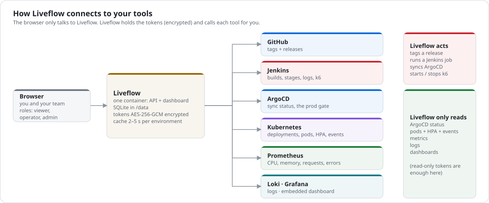

# How Liveflow works

> **In short:** Liveflow never runs your builds or your containers. It **reads** your tools, draws what is happening, and **asks** them to act when you press a button.

<picture>
  <source media="(prefers-color-scheme: dark)" srcset="images/connections-dark.svg">
  
</picture>

## The words Liveflow uses

| Word | Meaning | Example |
|---|---|---|
| **App** | one product, with its own repo and environments. Picked at the top left | `Retail Store` |
| **Environment** | where the app runs: `dev`, `staging` or `prod` | `staging` |
| **Runtime** | how an environment runs: **Docker Compose** (one server) or **Kubernetes** | dev = Compose, staging/prod = Kubernetes |
| **Services** | the Kubernetes Deployments (or Compose services) of one environment. The **first** one is the main service: its version and HPA speak for the environment | `ui, catalog, cart, orders, checkout` |
| **Integration** | a connection to one tool: URL + token | `jenkins-main` |
| **Delivery path** | the row of stations at the top of the Flow page | GitHub → Jenkins → ArgoCD → Cluster |
| **Gate** | prod only: ArgoCD has a new version but waits until someone presses **Sync** | `v2.1.0 → v2.2.0` |

## The delivery path

| Runtime | Stations |
|---|---|
| Kubernetes | **GitHub → Jenkins → ArgoCD → Cluster** |
| Docker Compose | **GitHub → Jenkins → Dev server** |

Each station is read from the real tool, every few seconds:

| Station | Comes from | Shows |
|---|---|---|
| GitHub | the latest Jenkins build (its commit, tag or trigger) | what changed and who triggered it |
| Jenkins | the environment's Jenkins job | running / passed / failed, the stages of your Jenkinsfile |
| ArgoCD | the environment's ArgoCD application | Synced / OutOfSync / Progressing, and the **gate** on prod |
| Cluster / Dev server | Kubernetes API, or cAdvisor through Prometheus | pods per service, versions, rolling updates, HPA |

The big sentence on top (“stg-d41e0a7 is rolling out”, “v2.2.0 is ready. Production is waiting on you”) is built from these stations.

## What happens on each environment

| | dev | staging | prod |
|---|---|---|---|
| Deploys when | you push to the branch | you merge to the branch | **someone presses Sync** |
| Buttons | Run pipeline | Run pipeline · Stress test | Create release · Roll back · Sync |
| Deploy mode | — | auto | **always manual** |

## Safety built in

- **Production never changes by itself.** A prod environment cannot be set to auto-sync.
- Every prod action asks you to **type `prod`** first.
- **One pipeline at a time** per environment; Sync is refused while Jenkins is still running.
- **Roles:** viewers watch, operators act, admins also change settings.
- Every action is **logged** with who did it, and shown on the timeline.
- Tokens are stored **encrypted**; the browser never sees them.

---

| [← Guide home](README.md) | [Guide home](README.md) | [Install and run →](02-install.md) |
|:---|:---:|---:|
