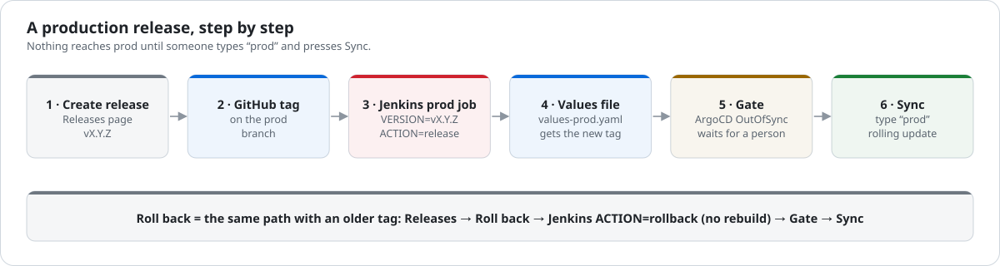

# Using it every day

> **In short:** the **Flow** page tells you what is happening; the buttons on it, on **Releases** and on **Stress** let you act.

## Flow page

| Part | What it shows |
|---|---|
| Headline | one sentence: building, rolling out, waiting on you, live, needs attention |
| Delivery path | the stations, live. Click **View run** for the Jenkins log |
| Numbers | running version, pods, CPU, requests per second, errors |
| Services | one row per service when the environment has several |
| Gate | prod only, when a new version waits for Sync |
| Signals | charts with deploys and stress tests marked on them |
| What just happened | Jenkins, ArgoCD, Kubernetes, HPA and people on one timeline |
| Logs | Loki, newest first, filter by text or level |

## Deploy to dev or staging

Push or merge to the branch: Jenkins starts by itself and the path moves. To re-run without a commit, press **Run pipeline** (operator). Only one pipeline runs at a time per environment.

## Release to production

<picture>
  <source media="(prefers-color-scheme: dark)" srcset="images/release-path-dark.svg">
  
</picture>

1. **Releases → New release.** Type a version newer than the latest tag (`v2.3.0`). Type `prod` to confirm.
2. Liveflow creates the GitHub tag and starts the prod Jenkins job with `VERSION` and `ACTION=release`.
3. When Jenkins is done, ArgoCD shows **OutOfSync** and the **gate** appears: `v2.2.0 → v2.3.0`.
4. Check the numbers, then type `prod` and press **Sync**. Pods are replaced one by one.

You cannot Sync while the prod job is still running.

## Roll back production

**Releases → Roll back** next to an older version → type `prod`. Jenkins runs with `ACTION=rollback` (no rebuild), then **Sync** from the gate. Rollback is a prod action; on dev and staging, revert the commit instead.

## Stress test (staging)

**Stress →** choose virtual users (1–500) and duration (10–600 s) → **Start**. Watch pods and CPU react; the HPA adds pods. **Stop** ends it early. One test at a time.

## Who can do what

Viewers see the buttons disabled with the reason. Operators and admins can act. Everything you do appears in *What just happened* with your name.

---

| [← Environments](05-environments.md) | [Guide home](README.md) | [What your Jenkinsfiles must do →](07-jenkins-contract.md) |
|:---|:---:|---:|
